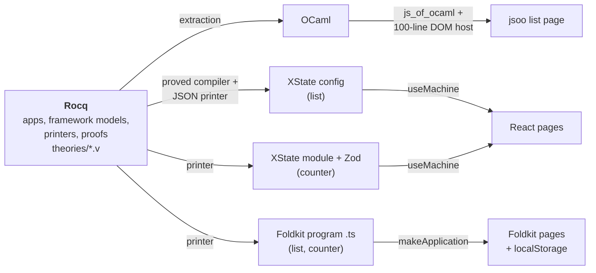

# Verified list UI

UI logic written and proved correct in [Rocq](https://rocq-prover.org), then compiled to the browser three ways: with js_of_ocaml, as an [XState](https://stately.ai/docs/xstate) machine under React, and as a [Foldkit](https://foldkit.dev) TypeScript program. Rocq generates the code the browser runs, and the proofs are about that code. None of the app logic is written by hand.

> **Status: research spike.** 113 theorems, no axioms, and `make check` passes on macOS (arm64). The point is to find out how much of a real UI stack a proof can reach, and what has to stay trusted.

## The apps

There are two small apps, and each needs something the other doesn't:

- **The list.** Three items. Click one to select it, delete the selected item, or reset. The state is a list of `{ id, label }` records and an optional selection.
- **The capped counter.** Add or subtract any amount, reset, lock, and unlock. The count must stay below 500 whatever events arrive. The counter has infinitely many states.

On the Foldkit path, both apps save to `localStorage` after every accepted click and restore at start-up. The proofs cover whatever the store holds, including values that another tab or a person wrote by hand.

## How it works



Each back end answers a different question.

| back end | what Rocq produces | what the proofs reach | what stays trusted |
| --- | --- | --- | --- |
| **js_of_ocaml** | the whole `update` and `view`, extracted to OCaml and compiled to JavaScript | the abstract view: which rows show, which one is highlighted, and when Delete is enabled | extraction, js_of_ocaml, a 100-line DOM host |
| **XState, flat** | a JSON machine config with one state per reachable app state (20 states) | `compile_correct`: the machine matches `update` on every event sequence | a JSON printer, and the claim that XState runs flat machines as `XState.v` models them |
| **XState with context** | an ES module with guards, `assign` actions, and Zod event schemas | the cap holds for any JavaScript events, including malformed payloads | the printer, XState's handling of the subset used, Zod |
| **Foldkit** | a TypeScript module: Effect Schemas, the message union, `update`, `can`, a save command, and `restore` | invariants after any list of messages, starting from any stored value | the printer (296 lines), the runtime folding messages through `update`, the store, a hand-written view |

On the Foldkit path, the app is a fold (`fold_left update messages init`), so the Rocq model and the runtime agree on the basic shape. The model, `theories/Fold.v`, is a small language: typed fields with Schema maxima, a clause table for `update`, and a save command. Both apps are programs in that language, and one generic theorem proves invariants for any program:

```coq
(* If every clause keeps P, and P holds for whatever restore returns,
   then P holds after any messages, from any stored value. *)
Theorem fold_keeps P p st msgs :
  keeps P p -> restores P p -> P (f_run p (restore p st) msgs).
```

Here is the list app in that language. The `true` at the end of each clause means "save":

```coq
Definition select_clause : clause :=
  mkClause [] GTrue [CHas "items" EArg] [] [] [("selected", OSome EArg)] [] true.
Definition delete_clause : clause :=
  mkClause [] GTrue [CSet "selected"] [] [] [("selected", ONull)] [("items", LDrop "selected")] true.
```

And here is part of the TypeScript that Rocq prints from it:

```ts
case "ClickedDelete": {
  if (!Schema.is(Message.ClickedDelete)(message)) return undefined;
  if ((model.selected !== null)) {
    const next: Model = { selected: null, items: model.items.filter((it) => it.id !== model.selected) };
    return { model: next, commands: [SaveList({ selected: next.selected, items: next.items })] };
  }
  return undefined;
}
```

## What is proved

Some of the headline results. The [details](docs/DETAILS.md) have every theorem.

| claim | theorems |
| --- | --- |
| After any sequence of events, the list's ids are distinct and the selection is one of them | `run_preserves_validity`, `trace_valid` |
| Delete removes exactly the selected item and keeps the rest in order | `delete_selected_spec` |
| The view lists the items in order, highlights exactly the selected one, and enables Delete exactly when something is selected | `view_rows_match_items`, `view_exactly_one_selected`, `view_delete_enabled_iff` |
| The generated XState machine follows the app event for event, and its `meta` is the view | `compile_correct` |
| The counter stays below 500 for any events, and for any JavaScript events sent through the Zod schemas | `count_below_limit`, `js_count_below_limit` |
| Foldkit counter: below 500 after any messages from any stored value, and so is every save | `fold_below_cap`, `saves_below_cap` |
| Foldkit list: whatever `localStorage` holds, the app starts from a valid state and stays valid | `restore_valid`, `fold_valid` |
| A save restores to exactly what was saved | `save_restore`, `fold_saves_restore` |
| Every number the printed code computes is a safe integer | `js_exact`, `fold_exact` |

`make assumptions` runs `Print Assumptions` on 113 theorems, and the build fails unless every one is closed under the global context. The development has no `Admitted`, `admit`, or `Axiom`.

## What is trusted

The proofs are about Rocq models. These pieces connect the models to the running page. They are trusted and tested, but not proved:

- **Rocq's kernel and extraction, OCaml, and js_of_ocaml.**
- **The printers** (`Json.v`, `CtxJs.v`, `FoldTs.v`). They are written in Rocq, but nothing models what their output means. `tsc` type-checks the printed modules.
- **The frameworks.** XState and Foldkit must run the printed code the way `XState.v`, `XStateCtx.v`, and `Fold.v` model them. Node tests run the printed code under the pinned versions against oracles that Rocq computes from the models. They cover thousands of sampled steps, random traces, a 40,000-message fuzz, malformed payloads, and malformed stored strings.
- **Hand-written glue.** This means the jsoo host, the React components, and the Foldkit views (`list.ts` is 79 lines). 49 Playwright tests check them across all three front ends.
- **The browser and `localStorage`.** Pixels, CSS, layout, and accessibility are not verified.

Mutation tests check that the test suite has teeth. A mutation is a deliberate bug in the printed code, a view, or a Rocq definition, and almost all of them are caught, by a failing proof or by failing tests. The [details](docs/DETAILS.md) list each one, including the few that are not caught and why.

## Quick start

Tested on macOS 27 (arm64). You need Homebrew `opam` 2.6.1 with `pkgconf` and `gmp`, Node 22 or later, and pnpm 10.

```sh
brew install opam pkgconf gmp
opam init --bare --no-setup -y   # once per machine
make setup   # local opam switch in ./_opam (several minutes), pnpm install, Playwright's Chromium
make check   # proofs, axiom audit, code generation, Node tests, all front ends, browser tests
```

Then serve a front end at http://127.0.0.1:8080/ (set `PORT=…` to change the port):

```sh
make serve           # the jsoo list
make serve-react     # React + XState: the list at /, the counter at /counter.html
make serve-foldkit   # Foldkit: the list at /, the counter at /counter.html, both saved to localStorage
```

All commands run inside the project's local opam switch, so you don't need `eval $(opam env)`. Generated code lives only in `_build/`. When a `.v` file changes, dune re-checks the affected proofs, then regenerates and rebuilds everything downstream. A failing proof fails the build, so the build never falls back to stale output.

## Layout

| path | contents |
| --- | --- |
| `theories/` | Rocq: the two apps, models of XState and Foldkit, the compiler and printers, and all proofs |
| `extraction/`, `xstate/`, `counter/`, `foldkit/` | extraction entry points, and small emitters that write the generated files into `_build/` |
| `browser/` | the js_of_ocaml host and its static page |
| `react/` | React pages that run the generated XState machines |
| `foldkit-web/` | Foldkit pages that run the generated programs |
| `tests/` | Node oracle tests (`xstate/`, `counter/`, `foldkit/`) and Playwright specs (`browser/`) |
| `assumptions/`, `scripts/` | the axiom audit, and a static file server |
| `docs/` | the long-form write-ups |

## Further reading

- **[docs/DETAILS.md](docs/DETAILS.md)** is the full technical write-up. For each back end it covers the definitions, the theorem tables, the trust boundary, what each test checks, and the negative controls.
- **[docs/REPORT.md](docs/REPORT.md)** is the implementation log: the commands that were run, what broke along the way, and a dated entry for each follow-up.

## Toolchain

Rocq 9.2.0 · OCaml 5.3.0 · dune 3.23.1 · js_of_ocaml 6.5.0 · XState 5.33.3 · Zod 4.6.7 · Foldkit 0.168.0 · Effect 4.0.0 · React 19.3.1 · Vite 8.3.5 · TypeScript 7.0.2 · Playwright 1.64.1

`verified-list-ui.opam.locked` and `pnpm-lock.yaml` pin every transitive dependency.
