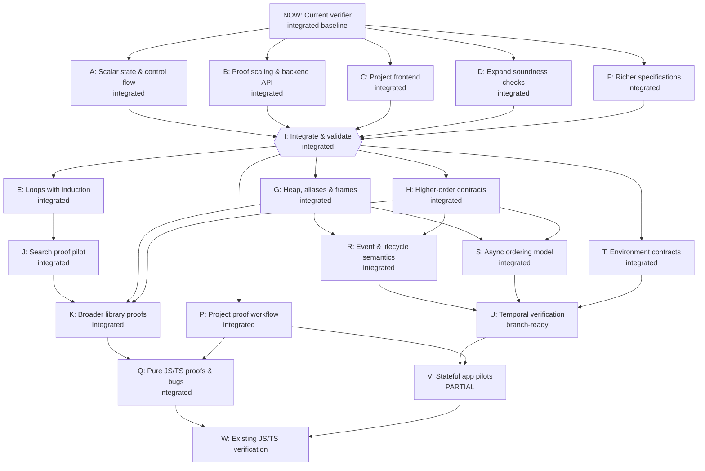

# Source verifier roadmap

Status as of 2026-11-14: R/S/T are integrated. U is ready in PR18 after535/535 hosted tests and a fresh ten-stage model-bound campaign; actual merge pending. V has a pinned native lifecycle regression and a selected source-bridge design, with the first callable-cell compiler unit in progress. W remains open.

All prerequisites apply. Integrated nodes refer to their documented first-layer subsets. U can build on the landed stateful safety and explicit-environment foundation; V and W still require maintained real stateful source proofs. Transitively redundant edges are omitted.



## Combined validation

Integration checkpoint I passed 168/168 tests, including the three Remeda checks that timed out on D's isolated branch. That run detected all eight original verifier mutants. [Integration report](../verify/reports/integration.md).

## Loop induction delivery

E was merged at `80ed2fd`. Its delivery suite passes 189 tests, including 21 loop tests. The expanded corpus detects 10 verifier mutants. [Loop validation report](https://github.com/rickono/verified-list-ui/blob/f76a14625340ca5426937d9034fd1c143e5da2d7/verify/reports/loops.md). J builds on this integrated capability.

## Upstream search delivery

J was merged at `91c2806`. The pinned Lodash strictIndexOf function verifies unchanged, and 2 seeded bugs produce replay-confirmed counterexamples. The combined run passed 199/199 tests. The raw export passes 261 native comparisons. [Search validation report](../verify/reports/upstream-search.md).

## Pure callback delivery

H is integrated on `feat/pure-callback-contracts`. Pure total unary numeric predicates compose with immutable primitive captures and checked named callbacks. The pinned Ramda eager findIndex verifies unchanged; 2 seeded bugs replay, with 42 independent native comparisons. The full suite passes 219/219 and all 12 verifier mutants are detected. [Callback validation report](../verify/reports/callbacks.md). Stateful callbacks remain outside this delivery.

## Heap and frame delivery

G is integrated on `feat/heap-alias-frames`, building on H. Shared identities, shallow copies, entry heaps, primitive stores and per-write mutation frames compose through helper calls. The full suite passes 249/249; 4 heap-specific verifier mutants join the 12 existing mutants. [Heap validation report](../verify/reports/heap.md). At the G checkpoint, mutating loops, reference stores and stateful callbacks remained outside that delivery; later K and stateful sections record extensions. K subsequently integrated these prerequisites.

## Stateful safety foundation

C1 is integrated: source-linked scalar await segments use init, step and interference/keeps over unbounded activations. The focused run passes 49/49; the combined suite passes 371/371. [Acceptance and scope](../verify/reports/roadmap/C1-landing.md). C1 alone did not deliver cancellation, listeners, counts or liveness; later units are recorded separately.

## Stateful protocols and environment contracts

R, S and T are integrated in the documented C1/C2a domain at `a60ae39`. The combined suite passes 510/510, including 8 abort-binding checks; the current-model numerical campaign passes 10 stages. Original native review PASS and proof review ISSUES are preserved with the coordinator's tested correction. [Acceptance, source bindings and limits](../verify/reports/roadmap/RST-landing.md). Conditional completion U and real stateful factory proof V remain open.

## Original branch results

These counts describe the original isolated branches. D's original partial result is retained as historical evidence; the combined validation above closes that acceptance gap.

| Work | Commit and report | Reported validation |
| --- | --- | --- |
| A: Scalar state & control flow | [46c8f78](https://github.com/rickono/verified-list-ui/blob/46c8f7884b3447a72ccae7e2cc95f43390baf4a2/verify/reports/ready-A.md) on `t3/implement-ready-node-a` | 100 passed, 0 failed |
| B: Proof scaling & backend API | [abd0bf5](https://github.com/rickono/verified-list-ui/blob/abd0bf5202729b1fa0872613c7bfdd46a06a1d93/verify/reports/ready-B.md) on `t3/proof-backend-scheduling` | 104 passed, 0 failed |
| C: Project frontend | [304587c](https://github.com/rickono/verified-list-ui/blob/304587c9a827b3bf38912b4c5acf1ed9a12da11e/verify/reports/ready-C.md) on `t3/implement-ready-node-c` | 105 passed, 0 failed; final frontend recheck 22/22 after the last path fix |
| D: Expand soundness checks | [4a628d3](https://github.com/rickono/verified-list-ui/blob/4a628d3d5c76f6d0d0b893e2019073d7fbf8740d/verify/reports/ready-D.md) on `t3/implement-ready-node-d` | 84 passed, 3 failed; focused corpus passed, eight seeded mutants detected; acceptance partial |
| F: Richer specifications | [3aa07f3](https://github.com/rickono/verified-list-ui/blob/3aa07f3fa9901057e62de195ff5d2210c69679c2/verify/reports/ready-F.md) on `t3/implement-ready-now-node-f` | 102 passed, 0 failed |

## Data and updates

[The graph data](verification-roadmap.json) contains the dependency edges, capability requirements, acceptance criteria and branch evidence. The integration baseline is `ff2518cd7494300084f2ab54da71f4d79185e586`.

Ready packages: .
Branches awaiting integration: U.

To regenerate this document after editing the data:

```sh
python3 scripts/render-verification-roadmap.py
```
