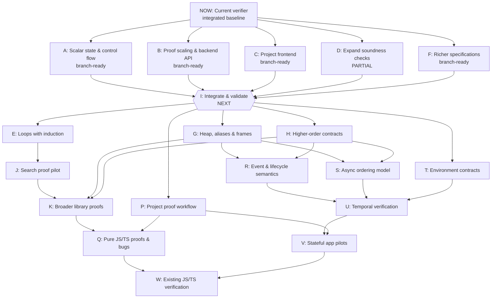

# Source verifier roadmap

Status as of 2026-11-09: A, B, C and F are ready in separate branches for their documented subsets. D is partial because three baseline Remeda checks returned unknown. No implementation branches are merged, and no downstream work has started.

I is the next integration and combined-validation checkpoint. All incoming prerequisites apply. Inputs to I are delivered branch artifacts, including D with its unresolved acceptance gap. Downstream work requires I to pass. Transitively redundant edges are omitted.



## Independent branch results

Test counts below describe each isolated branch. There is no combined integration result.

| Work | Commit and report | Reported validation |
| --- | --- | --- |
| A: Scalar state & control flow | [46c8f78](https://github.com/rickono/verified-list-ui/blob/46c8f7884b3447a72ccae7e2cc95f43390baf4a2/verify/reports/ready-A.md) on `t3/implement-ready-node-a` | 100 passed, 0 failed |
| B: Proof scaling & backend API | [abd0bf5](https://github.com/rickono/verified-list-ui/blob/abd0bf5202729b1fa0872613c7bfdd46a06a1d93/verify/reports/ready-B.md) on `t3/proof-backend-scheduling` | 104 passed, 0 failed |
| C: Project frontend | [304587c](https://github.com/rickono/verified-list-ui/blob/304587c9a827b3bf38912b4c5acf1ed9a12da11e/verify/reports/ready-C.md) on `t3/implement-ready-node-c` | 105 passed, 0 failed; final frontend recheck 22/22 after the last path fix |
| D: Expand soundness checks | [4a628d3](https://github.com/rickono/verified-list-ui/blob/4a628d3d5c76f6d0d0b893e2019073d7fbf8740d/verify/reports/ready-D.md) on `t3/implement-ready-node-d` | 84 passed, 3 failed; focused corpus passed, eight seeded mutants detected; acceptance partial |
| F: Richer specifications | [3aa07f3](https://github.com/rickono/verified-list-ui/blob/3aa07f3fa9901057e62de195ff5d2210c69679c2/verify/reports/ready-F.md) on `t3/implement-ready-now-node-f` | 102 passed, 0 failed |

## Data and updates

[The graph data](verification-roadmap.json) contains the dependency edges, capability requirements, acceptance criteria and branch evidence. The baseline is `ff2518cd7494300084f2ab54da71f4d79185e586` on `js-source-verifier`. This roadmap is on `ready-now-coordinator`.

To regenerate this document after editing the data:

```sh
python3 scripts/render-verification-roadmap.py
```
